# ShopSphere: Enterprise Event-Driven E-Commerce Microservices Platform 🛍️⚡

[](https://openjdk.org/)
[](https://spring.io/projects/spring-boot)
[](https://kafka.apache.org/)
[](https://www.postgresql.org/)
[](https://redis.io/)
[](https://nextjs.org/)
[](https://www.docker.com/)

---

## 🌟 Overview

**ShopSphere** is a production-grade, distributed, event-driven e-commerce platform architected using **Java 21**, **Spring Boot 3.3.4**, **Apache Kafka**, **Redis**, **PostgreSQL**, and **Next.js 14**. It demonstrates modern distributed systems patterns including **Database-per-Service**, **Transactional Outbox Pattern**, **Saga Choreography & Compensatory Rollbacks**, **Resilience4j Circuit Breakers**, **Optimistic Concurrency Locking**, **Idempotent Payment Processing**, and **Multi-Tier Caching**.

---

## 🏛️ System Architecture

```mermaid
flowchart TD
    subgraph Clients["Frontend & Intelligent Clients"]
        Web["Next.js 14 Modern Storefront\n(Port 3000)\n• AI Copilot Advisor\n• Multi-Currency Engine\n• Spec Comparison Matrix\n• VIP Loyalty Points\n• Spatial Audio Tester"]
    end

    subgraph Edge["Edge Layer"]
        Gateway["Spring Cloud API Gateway\n(Port 8080)\nJWT Auth Validation & Routing\nResilience4j Circuit Breakers"]
    end

    subgraph Microservices["Core Microservices Cluster"]
        Auth["Auth Service\n(Port 8081)\nJWT & Token Blacklist"]
        User["User Service\n(Port 8082)\nProfiles & Addresses"]
        Product["Product Service\n(Port 8083)\nCatalog & Categories"]
        Search["Search Service\n(Port 8084)\nFull-Text Search Engine"]
        Cart["Cart Service\n(Port 8085)\nRedis In-Memory Cart"]
        Wishlist["Wishlist Service\n(Port 8086)\nRedis Wishlists"]
        Inventory["Inventory Service\n(Port 8087)\nOptimistic Version Locking"]
        Order["Order Service\n(Port 8088)\nSaga Coordinator & Orders"]
        Payment["Payment Service\n(Port 8089)\nIdempotent Transactions"]
        Coupon["Coupon Service\n(Port 8090)\nRules Engine & Discounts"]
        Shipping["Shipping Service\n(Port 8091)\nFedEx Dispatch & Tracking"]
        Review["Review Service\n(Port 8092)\nVerified Ratings & Reviews"]
        Notification["Notification Service\n(Port 8093)\nEvent Feeds & Dispatches"]
        Analytics["Analytics Service\n(Port 8094)\nReal-Time Metrics & KPIs"]
    end

    subgraph DataPlane["Data & Event Mesh"]
        Kafka["Apache Kafka\n(Port 9092 / 29092)\nEvent Streaming Mesh"]
        Redis["Redis Cache & Cluster\n(Port 6379)"]
        Postgres["PostgreSQL Multi-DB\n(Port 5432)"]
    end

    Web --> Gateway
    Gateway --> Auth
    Gateway --> User
    Gateway --> Product
    Gateway --> Search
    Gateway --> Cart
    Gateway --> Wishlist
    Gateway --> Inventory
    Gateway --> Order
    Gateway --> Payment
    Gateway --> Coupon
    Gateway --> Shipping
    Gateway --> Review
    Gateway --> Notification
    Gateway --> Analytics

    Auth --> Postgres
    Auth --> Redis
    Auth --> Kafka
    User --> Postgres
    User --> Kafka
    Product --> Postgres
    Product --> Redis
    Product --> Kafka
    Search --> Postgres
    Search --> Kafka
    Cart --> Redis
    Wishlist --> Redis
    Inventory --> Postgres
    Inventory --> Kafka
    Order --> Postgres
    Order --> Kafka
    Payment --> Postgres
    Payment --> Kafka
    Coupon --> Postgres
    Shipping --> Postgres
    Shipping --> Kafka
    Review --> Postgres
    Notification --> Kafka
    Analytics --> Postgres
    Analytics --> Kafka
```



---

## 🚀 Microservices Matrix

| Microservice | Port | Database | Primary Technologies | Events Emitted / Consumed |
|---|---|---|---|---|
| **API Gateway** | `8080` | None | Spring Cloud Gateway, Reactive Filters, JWT | Enriches `X-User-Id`, `X-User-Role` headers |
| **Auth Service** | `8081` | PostgreSQL (`shop_auth`) | Spring Security 6, JWT, BCrypt, Redis Blacklist | Emits `user-events` (USER_REGISTERED) |
| **User Service** | `8082` | PostgreSQL (`shop_users`) | Spring Data JPA, Address Book CRUD | Consumes `user-events` |
| **Product Service** | `8083` | PostgreSQL (`shop_products`) | Redis Cache-Aside, Outbox Pattern | Emits `product-events` |
| **Search Service** | `8084` | PostgreSQL FullText | Full-Text ILIKE & Re-indexing | Consumes `product-events` |
| **Cart Service** | `8085` | Redis In-Memory | Redis Template, Subtotal Calculator | Guest cart merging, TTL expiration |
| **Wishlist Service** | `8086` | Redis In-Memory | Redis Sets, Fast Lookup | Wishlist persistence |
| **Inventory Service** | `8087` | PostgreSQL (`shop_inventory`) | Optimistic Locking (`@Version`), Saga Participant | Consumes `order-events`, Emits `inventory-events` |
| **Order Service** | `8088` | PostgreSQL (`shop_orders`) | Saga Coordinator, State Machine, Outbox | Emits & Consumes `order-events` |
| **Payment Service** | `8089` | PostgreSQL (`shop_payments`) | Idempotency (`Idempotency-Key`), Mock Gateway | Consumes `order-events`, Emits `payment-events` |
| **Coupon Service** | `8090` | PostgreSQL (`shop_coupons`) | Discount Rules Engine (`SAVE20`, `WELCOME10`) | Validates coupons & order minimums |
| **Shipping Service** | `8091` | PostgreSQL (`shop_shipping`) | FedEx Tracking (`TRK-FEDEX-XXXX`), Stepper | Consumes `order-events`, Emits `shipping-events` |
| **Review Service** | `8092` | PostgreSQL (`shop_reviews`) | Verified Ratings, Breakdown Aggregations | Verified purchase review management |
| **Notification Service** | `8093` | PostgreSQL / In-Memory | Multi-Channel Kafka Event Consumer | Consumes all event topics |
| **Analytics Service** | `8094` | PostgreSQL (`shop_analytics`) | Real-Time Kafka Stream Ingestion, KPI Aggregations | Calculates revenue velocity & metrics |

---

## ⚡ Distributed & Storefront Features

1. **AI Shopping Copilot Advisor**:
   Neural product consultation with conversational prompt chips, smart matching, and direct 1-click add to cart from the chat stream.
2. **Resilience4j Circuit Breaker & Chaos Simulator**:
   Live circuit state control (`CLOSED`, `OPEN`, `HALF-OPEN`) and Redis Cache Invalidation simulator within the Admin telemetry dashboard.
3. **VIP Loyalty Points & Rewards Tier Hub**:
   Accrue points on orders with progressive membership tiers (*Bronze, Silver, Gold, Diamond*) and redeem instant cart coupon vouchers.
4. **Interactive Spatial Audio Preview**:
   Acoustic noise-cancellation demo with sound equalizer visualizer for audio hardware.
5. **Multi-Currency Real-Time Engine**:
   Instant calculations across `USD ($)`, `EUR (€)`, `GBP (£)`, `INR (₹)`, `JPY (¥)`, `CAD (CA$)`, and `AUD (A$)`.
6. **Side-by-Side Spec Comparison**:
   Compare up to 4 items with floating docked launcher.
7. **Transactional Outbox Pattern**:
   Guarantees zero event loss. Mutations and Kafka event envelopes are written to the database in the same ACID transaction.
8. **Saga Choreography Pattern**:
   Asynchronous checkout choreography with automatic compensatory rollbacks across Order, Inventory, Payment, and Shipping services.

---

## 🛠️ Quickstart & Local Setup

### 1. Build Backend Microservices
```bash
# Build Parent POM, Common Library, and all 14 Microservices
mvn clean install -DskipTests
```

### 2. Launch Full Infrastructure with Docker Compose
```bash
docker-compose up --build -d
```

### 3. Run Frontend Storefront Locally
```bash
cd frontend
npm install
npm run dev
```
Open **[http://localhost:3000](http://localhost:3000)** in your browser!

---

## 🧪 Testing the Platform

### Default Credentials
- **Customer**: `pranesh@shopsphere.io` / `password123`
- **Admin**: `admin@shopsphere.io` / `adminpass123`

### Active Promo Codes
- `SAVE20`: 20% discount on order subtotal
- `WELCOME10`: 10% discount for first-time shoppers
- `FLAT50`: $50 flat discount on orders over $250
- `REWARD10`: $10 Loyalty Voucher
- `REWARD25`: $25 VIP Voucher

---

## 📊 Observability & Monitoring
- **Storefront & Admin UI**: [http://localhost:3000](http://localhost:3000)
- **API Gateway**: [http://localhost:8080](http://localhost:8080)
- **Kafka UI**: [http://localhost:8099](http://localhost:8099)
- **Prometheus**: [http://localhost:9090](http://localhost:9090)
- **Grafana**: [http://localhost:3001](http://localhost:3001) (`admin` / `admin`)
- **Jaeger Distributed Tracing**: [http://localhost:16686](http://localhost:16686)
