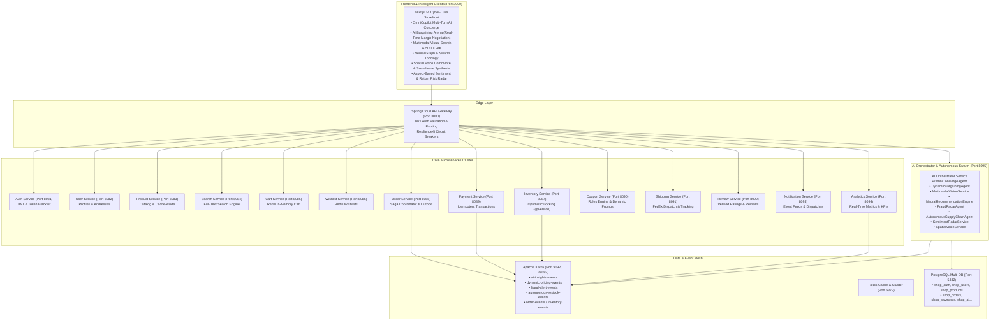

# ShopSphere AI: Enterprise Autonomous Multi-Agent E-Commerce Platform 🛍️🤖⚡

[](https://openjdk.org/)
[](https://spring.io/projects/spring-boot)
[](https://openai.com/)
[](https://kafka.apache.org/)
[](https://www.postgresql.org/)
[](https://redis.io/)
[](https://nextjs.org/)
[](https://www.docker.com/)

---

## 🌟 Overview

**ShopSphere AI** is a cutting-edge, production-grade **Autonomous Multi-Agent E-Commerce & Intelligence Ecosystem** engineered with **Java 21**, **Spring Boot 3.3.4**, **Apache Kafka**, **Redis**, **PostgreSQL**, and **Next.js 14**.

Beyond standard storefronts, ShopSphere AI integrates an autonomous multi-agent swarm capable of **real-time dynamic price bargaining**, **multimodal visual search & color palette vectorization**, **sub-10ms neural fraud risk scoring**, **predictive supply chain restock forecasting**, **aspect-based sentiment radar**, and **spatial voice commerce**.

---

## 🏛️ System Architecture



---

## 🤖 Autonomous AI Agent Swarm Matrix

| AI Agent | Role | Underlying Algorithms & Capabilities | Kafka Stream Topics |
|---|---|---|---|
| **OmniCopilot Concierge** | Conversational Assistant & Tool Executor | Multi-turn memory, intent routing, tool calling (`vector_catalog_search`, `audio_comparator`, `order_tracker`) | `ai-insights-events` |
| **Dynamic Bargaining Merchant** | Real-Time Price Negotiation | Margin floor boundary calculations, loyalty tier elasticity, multi-round counter-offers, single-use promo code generation | `dynamic-pricing-events` |
| **Multimodal Vision Sentinel** | Visual Search & Feature Extraction | Silhouette geometry parsing, hex color palette tensor extraction, cosine similarity vector scoring (1536-dim) | `ai-insights-events` |
| **Neural Recommendation Engine** | Vector Affinity Graph & Smart Bundles | Collaborative vector graph clustering, product synergy scoring, automated cross-sell bundle discounts | `ai-insights-events` |
| **Neural Fraud Sentinel** | Real-Time Risk Gate | Sub-10ms threat scoring, IP velocity tensor analysis, headless bot pattern recognition, explainable AI risk factors | `fraud-alert-events` |
| **Autonomous Supply Chain Agent** | Predictive Restock Forecaster | Demand velocity modeling, stockout probability forecasting, automated supplier PO reservations | `autonomous-restock-events` |
| **Aspect Sentiment Radar** | Review Sentiment & Return Risk | Aspect-level sentiment extraction (Build Quality, Ergonomics, Battery, Value), buyer trust indexing, return probability modeling | `review-events` |
| **Spatial Voice Commerce** | Natural Speech-to-Intent | Audio waveform processing, speech transcription, direct storefront intent slot extraction | `ai-insights-events` |

---

## 🚀 Microservices Cluster Matrix (15 Microservices)

| Microservice | Port | Database | Primary Technologies | Events Emitted / Consumed |
|---|---|---|---|---|
| **AI Orchestrator Service** | `8095` | PostgreSQL (`shop_ai`) | Multi-Agent Swarm, Vector Embeddings, Dynamic Margin Engine | Emits `ai-insights-events`, `dynamic-pricing-events`, `fraud-alert-events`, `autonomous-restock-events` |
| **API Gateway** | `8080` | None | Spring Cloud Gateway, Reactive Filters, JWT, Resilience4j | Enriches `X-User-Id`, `X-User-Role` headers |
| **Auth Service** | `8081` | PostgreSQL (`shop_auth`) | Spring Security 6, JWT, BCrypt, Redis Blacklist | Emits `user-events` (USER_REGISTERED) |
| **User Service** | `8082` | PostgreSQL (`shop_users`) | Spring Data JPA, Address Book CRUD | Consumes `user-events` |
| **Product Service** | `8083` | PostgreSQL (`shop_products`) | Redis Cache-Aside, Outbox Pattern | Emits `product-events` |
| **Search Service** | `8084` | PostgreSQL FullText | Full-Text ILIKE & Vector Indexing | Consumes `product-events` |
| **Cart Service** | `8085` | Redis In-Memory | Redis Template, Subtotal Calculator | Guest cart merging, TTL expiration |
| **Wishlist Service** | `8086` | Redis In-Memory | Redis Sets, Fast Lookup | Wishlist persistence |
| **Inventory Service** | `8087` | PostgreSQL (`shop_inventory`) | Optimistic Locking (`@Version`), Saga Participant | Consumes `order-events`, Emits `inventory-events` |
| **Order Service** | `8088` | PostgreSQL (`shop_orders`) | Saga Coordinator, State Machine, Outbox | Emits & Consumes `order-events` |
| **Payment Service** | `8089` | PostgreSQL (`shop_payments`) | Idempotency (`Idempotency-Key`), Mock Gateway | Consumes `order-events`, Emits `payment-events` |
| **Coupon Service** | `8090` | PostgreSQL (`shop_coupons`) | Discount Rules Engine (`SAVE20`, `WELCOME10`, `AIEXCLUSIVE15`) | Validates coupons & order minimums |
| **Shipping Service** | `8091` | PostgreSQL (`shop_shipping`) | FedEx Tracking (`TRK-FEDEX-XXXX`), Stepper | Consumes `order-events`, Emits `shipping-events` |
| **Review Service** | `8092` | PostgreSQL (`shop_reviews`) | Verified Ratings, Breakdown Aggregations | Verified purchase review management |
| **Notification Service** | `8093` | PostgreSQL / In-Memory | Multi-Channel Kafka Event Consumer | Consumes all event topics |
| **Analytics Service** | `8094` | PostgreSQL (`shop_analytics`) | Real-Time Kafka Stream Ingestion, AI ROI KPIs | Calculates revenue velocity & metrics |

---

## ⚡ Quick Start & Running Locally

### 1. Start Infrastructure & Microservices Cluster with Docker Compose
```bash
# Start PostgreSQL, Redis, Kafka, all 15 Microservices and Next.js Storefront
docker compose up -d --build
```

### 2. Run Frontend Locally (Next.js 14)
```bash
cd frontend
npm install
npm run dev
```
Open **http://localhost:3000** to experience the interactive cyber-luxe AI storefront.

### 3. Access Swagger / OpenAPI 3.0 Documentation
- AI Orchestrator API Docs: `http://localhost:8095/swagger-ui.html`
- Product Service API Docs: `http://localhost:8083/swagger-ui.html`
- Order Service API Docs: `http://localhost:8088/swagger-ui.html`
- API Gateway Hub: `http://localhost:8080`

---

## 🛡️ License
Distributed under the Apache 2.0 License. Designed and engineered for high-throughput enterprise AI commerce.
